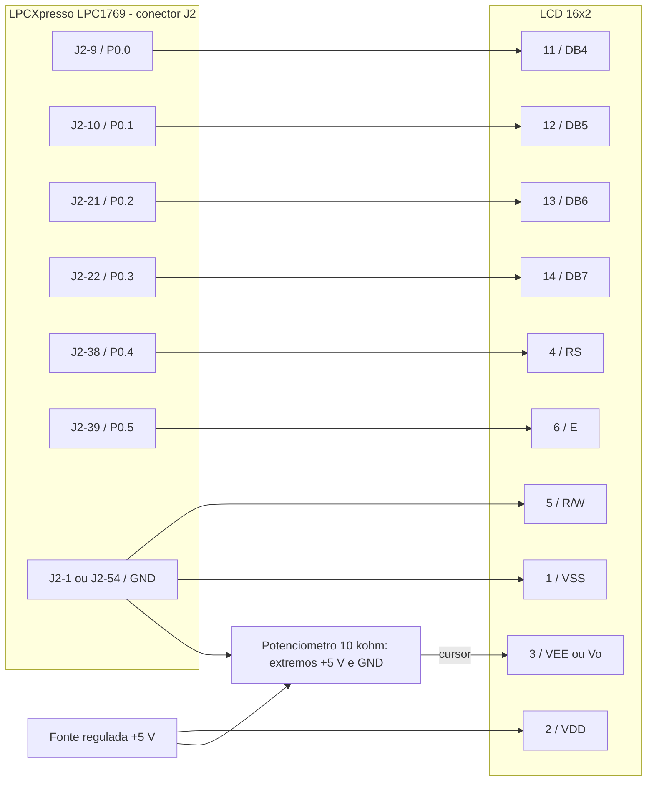

# Laboratorio 5 - ligacoes do LCD 16x2

Este esquema segue a proposta final do grupo G08: interface de 4 bits e so
escrita. Os numeros `J2-n` identificam contactos do conector da LPCXpresso;
os numeros `LCD n` identificam pinos do modulo.

DB0 a DB3 (pinos 7 a 10) ficam sem ligacao. No modulo NMTC-S16205DRGHS,
LEDA e LEDK (pinos 15 e 16) tambem nao sao usados. A fonte de +5 V e a
LPCXpresso devem partilhar GND. J2-2 e uma entrada VIN, nao uma saida de +5 V.

Antes de testar, confirmar o modelo exato do LCD montado e comparar os fios
com este esquema. A ligacao USB so confirma a interface de depuracao da placa.
